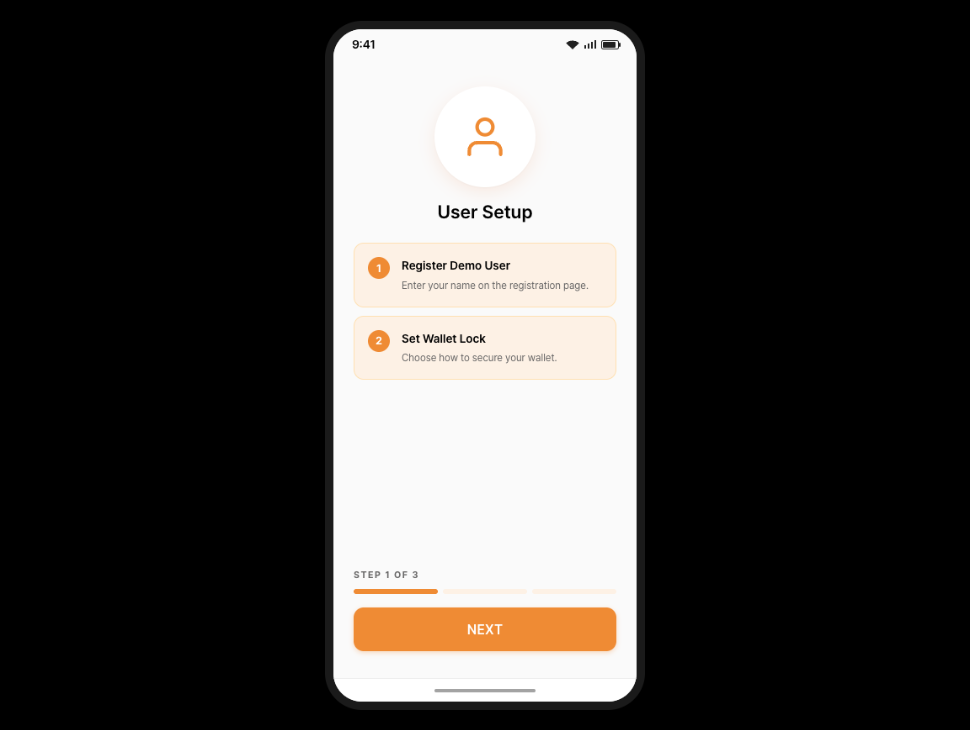
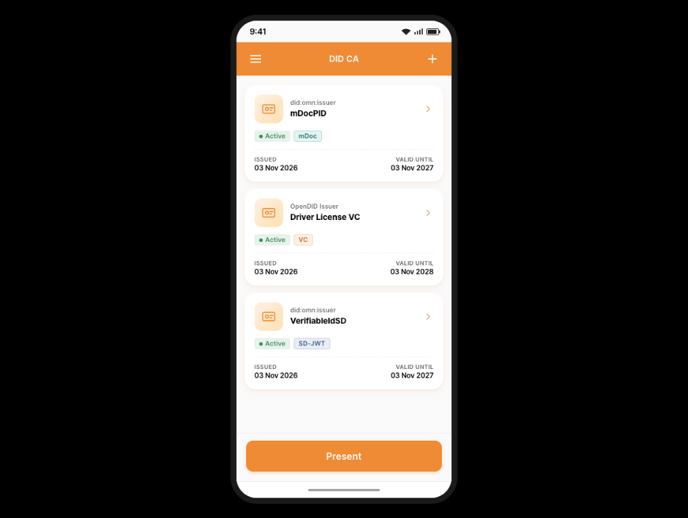

# OmniOne OpenDID Demo App Pages

Welcome to the **OmniOneID DemoApp Repository**! 
This repository contains the source code and deployment files for **OmniOneID DemoApp Pages**.

## Purpose
This demo website is designed to:
- **Enhance accessibility** by allowing users to experience OpenDID's functionality without installing an app.
- **Maintain consistency** by applying the same design as the app, minimizing any sense of unfamiliarity.

## Differences from the App
The DemoApp provides a user experience similar to the actual OmniOneID app but with the following differences:
- The **UI and interaction flow** are identical, but no real data is used.
- **QR codes for VC issuance and VP submission** are simulated and do not perform actual credential transactions.
- **LockType settings and fingerprint authentication** are not supported.
- In v3.0.0.0, **proximity presentation** is simulated with a verifier app shown next to the wallet; no BLE or NFC data is actually exchanged.
- In v3.0.0.0, a **demo-only popup** lets you choose the credential before scanning a QR code; the app does not show this popup.
- In v3.0.0.0, the **PIN and issued credentials** are kept only until the page is reloaded or the app is reset, and the wallet's **Server URL settings** are not available.

## Key Screens
- App Start Screen

- Main Screen

## Want to Try the Actual App?
If you’d like to use the real OmniOneID app, please visit the official repositories below:

### Wallet (CA) App
- **Android**: [OmniOneID Android CA Repository](https://github.com/OmniOneID/did-ca-aos.git)
- **iOS**: [OmniOneID iOS CA Repository](https://github.com/OmniOneID/did-ca-ios.git)

### Proximity Verifier App
- **Android**: [OmniOneID Android Proximity Verifier Repository](https://github.com/OmniOneID/did-proximity-verifier-android.git)
- **iOS**: [OmniOneID iOS Proximity Verifier Repository](https://github.com/OmniOneID/did-proximity-verifier-ios.git)

## License
[Apache 2.0](LICENSE)
