# Demo App Guide (V3.0.0.0)

## splash
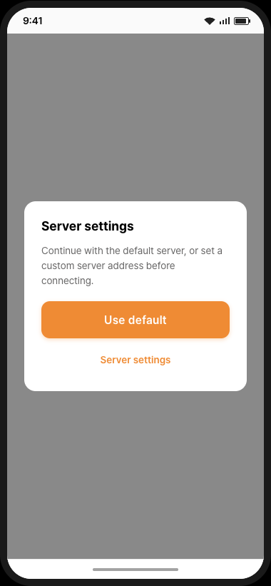

- The app starts on the splash screen and asks which server to connect to.
- `Use default` connects with the default server addresses and moves on to onboarding. (In the demo, no connection is made.)
- `Server settings` opens the server settings so you can set custom server addresses first. (In the demo, a popup says the feature is not available.)
- If the wallet has an Unlock PIN, the app opens the Unlock PIN screen instead. (In the demo, the Unlock PIN cannot be set, so this does not happen.)

## onboarding
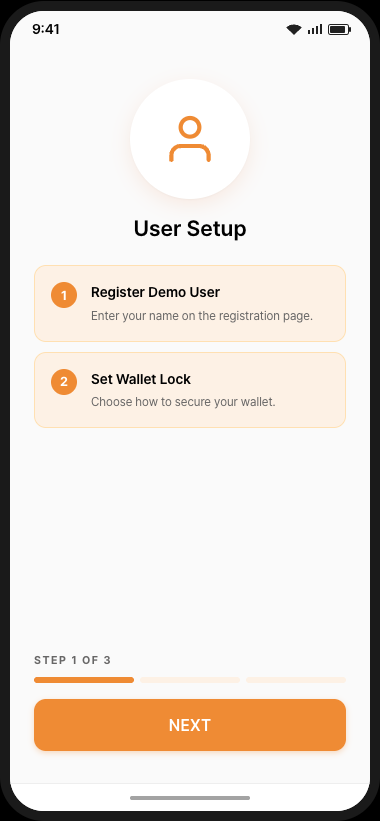

- Onboarding guides wallet setup in three steps. Press `NEXT` to run the current step.
- **Step 1 – User Setup**: register a user and choose whether to set a wallet lock.

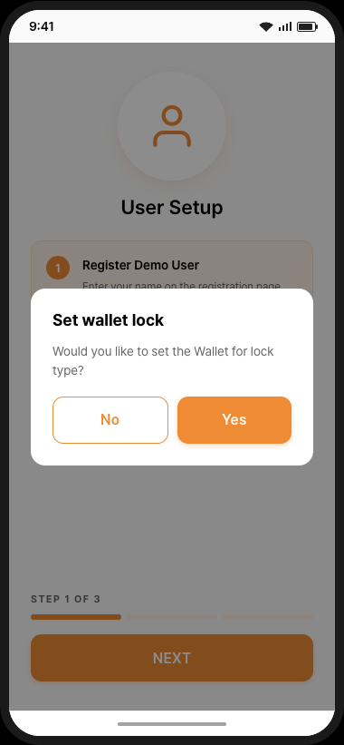

- After the user is registered, a popup asks whether to set a wallet lock.
  - `Yes` registers an Unlock PIN that locks the wallet. (In the demo, a popup says the feature is not available, and the wallet lock popup stays open.)
  - `No` skips the wallet lock.

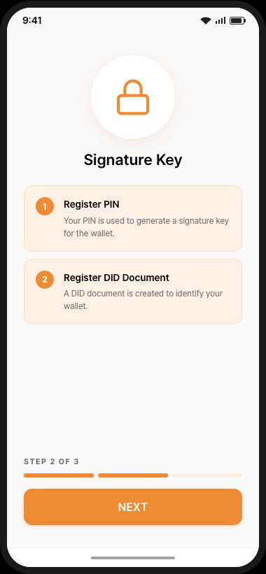

- **Step 2 – Signature Key**: register a PIN to generate the signature key, and create the user DID document.

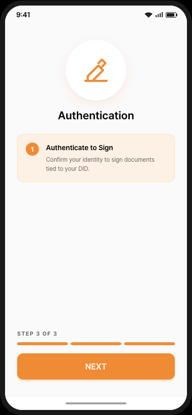

- **Step 3 – Authentication**: enter the PIN to sign and register the DID document. When this is done, the wallet opens.

## userInfoWebView
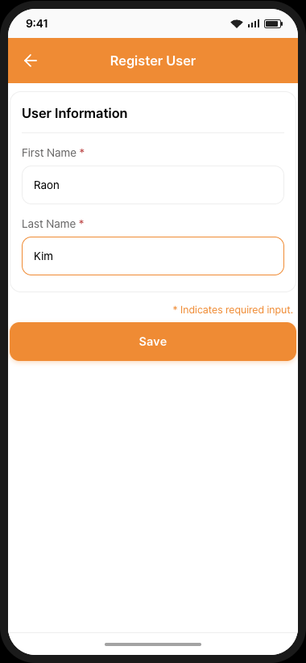

- The user registration page provided by the Demo server, shown in a web view. (In the demo, the page is simulated and nothing is sent.)
- Enter `First Name` and `Last Name`, then press `Save`. (In the demo, `Save` is enabled once both are entered.)

## pinRegister
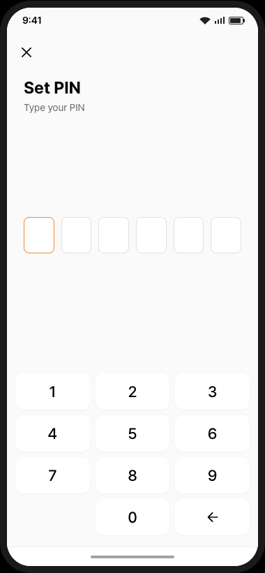

- Register a 6-digit PIN that is used for signing.
- Enter the PIN, then enter the same PIN again to confirm it.
- After registration, the app offers to register biometrics.

## biometricRegister
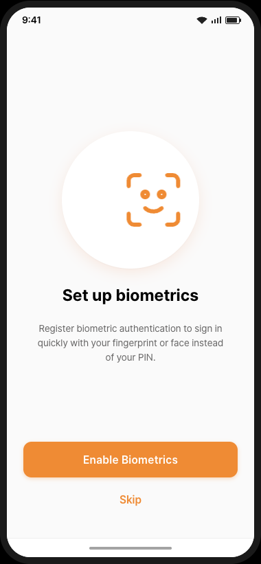

- Register biometric authentication (fingerprint or face) so you can sign without typing the PIN.
- `Enable Biometrics` registers it. `Skip` continues with the PIN only. (In the demo, `Enable Biometrics` shows a popup saying the feature is not available.)
- This screen is also available from Settings > `Add Biometrics`.

## pinAuth
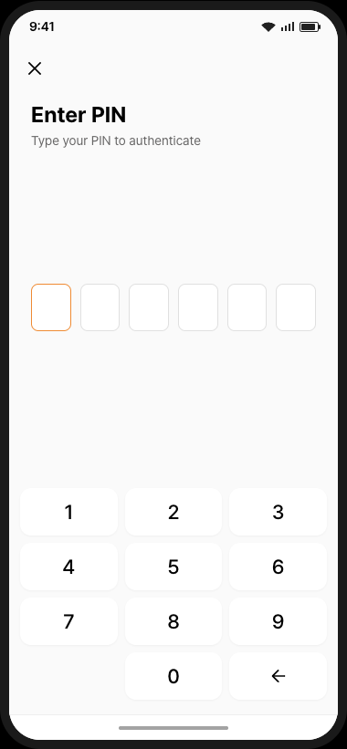

- Enter the registered PIN to authenticate. If the PIN is wrong, an error message is shown and the input is cleared; the message disappears after a few seconds.
- This screen appears whenever a signature is needed: DID document registration, certificate issuance and certificate presentation. It also appears before deleting a certificate.
- (In the demo, the PIN registered during onboarding, or the new PIN after `Change PIN`, is kept only in the page memory. Reloading or closing the page, or `Reset App`, clears it and onboarding starts again.)

## pinChange
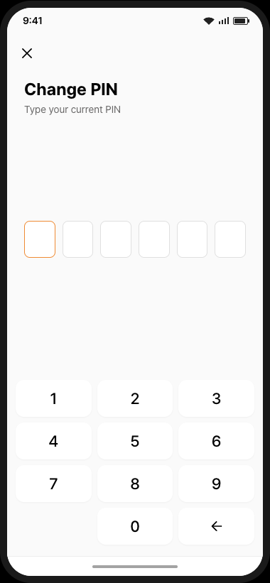

- Change the signing PIN. Open it from Settings > `Change PIN`.
- Enter the current PIN, then the new PIN, then the new PIN again. If the current PIN is wrong, an error message is shown and the input is cleared.
- (In the demo, the current PIN must match the registered PIN, the new PIN must be different, and after the change only the new PIN is accepted.)

## unlockRegister
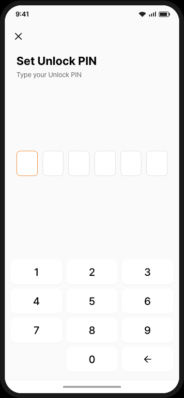

- Register the Unlock PIN that locks the wallet.
- It opens when you choose `Yes` on the wallet lock popup during onboarding. (In the demo, the wallet lock is not available, so this screen is not reached and is shown for reference only.)
- Enter the Unlock PIN, then enter it again to confirm it.

## unlockAuth
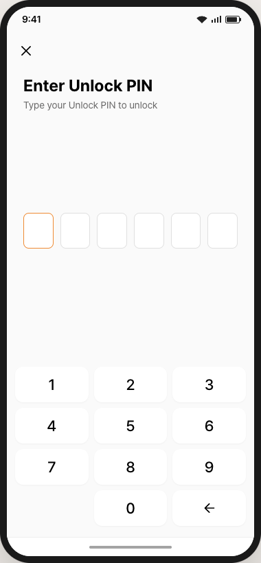

- When the wallet has an Unlock PIN, the app asks for it on launch.
- Enter the Unlock PIN to open the wallet. If it is wrong, an error message is shown and the input is cleared; the message disappears after a few seconds.
- (In the demo, launching again resets the wallet, so this screen is shown for reference only.)

## unlockChange
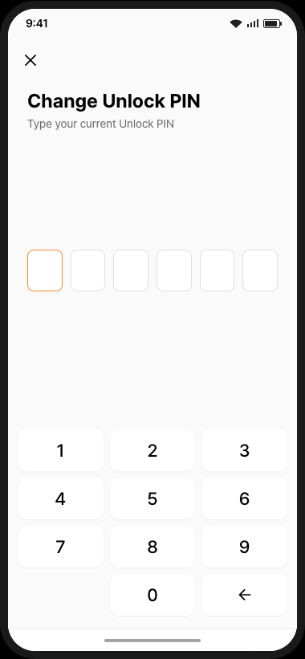

- Change the Unlock PIN. Open it from Settings > `Change Unlock PIN`.
- Enter the current Unlock PIN, then the new one, then the new one again.
- (In the demo, the Unlock PIN cannot be set, so an `Unlock PIN is not set` popup is always shown instead.)

## authMethod
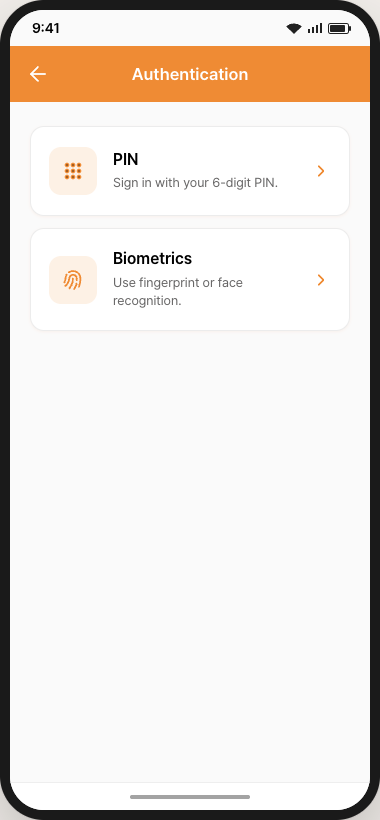

- Choose how to authenticate: `PIN` or `Biometrics`.
- This screen is for wallets that have both methods. (In the demo, it is not reached and is shown for reference only.)

## docsEmpty
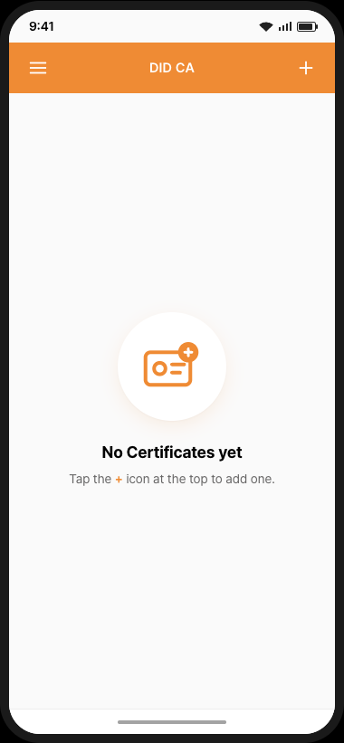

- The home screen when no certificate has been issued yet.
- Tap the `+` icon at the top or the card icon in the middle to add a certificate.
- The menu icon at the top left opens Settings.

## docsAdd
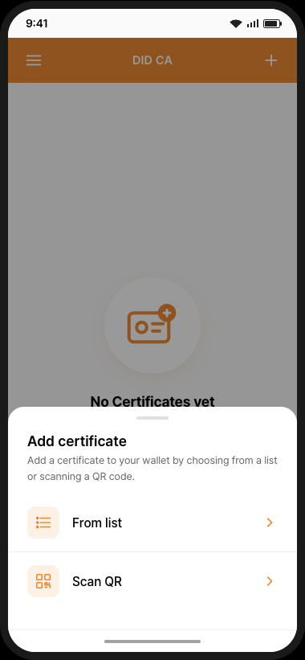

- The sheet for adding a certificate.
- `From list` chooses a certificate from the issuers' list (user-initiated issuance).
- `Scan QR` scans an issuance QR code (issuer-initiated issuance). (In the demo, there is no real issuer QR code, so a gray `Demo` popup first asks which credential to issue. `Cancel` stays on the home screen.)

## protocolSelect
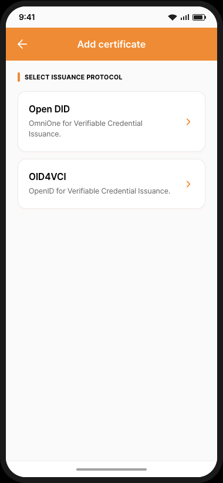

- Select the issuance protocol.
- `Open DID`: OmniOne for Verifiable Credential Issuance. Lists OpenDID VC certificates.
- `OID4VCI`: OpenID for Verifiable Credential Issuance. Lists mDoc and SD-JWT certificates.

## docsAddList
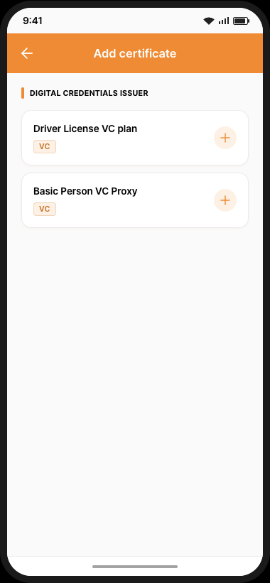

- The list of certificates that can be issued with the protocol you selected. (In the demo, the list is fixed to two certificates per protocol.)
- `Open DID` lists OpenDID VC certificates (`VC` badge).

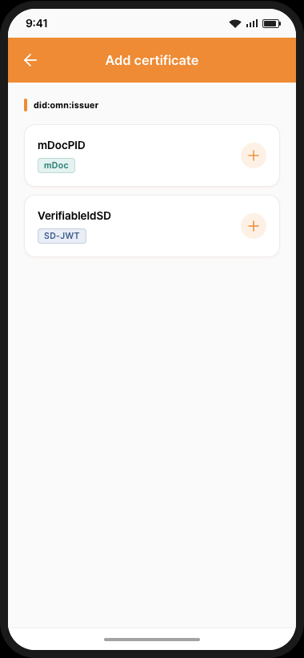

- `OID4VCI` lists mDoc and SD-JWT certificates (`mDoc` and `SD-JWT` badges).
- Select a certificate to open the information form, then enter the PIN to request issuance.

## issueForm
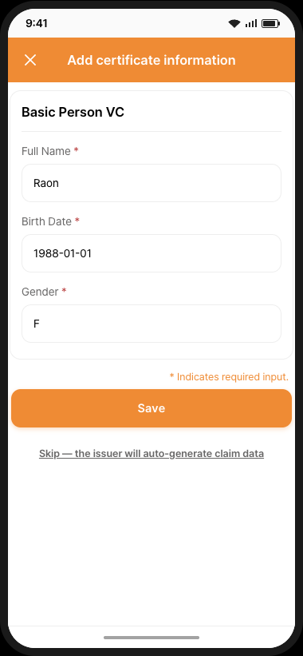

- Enter the information to include in the certificate. The issued certificate contains the values you saved. (In the demo, the fields are filled in with demo values that you can change.)
- `Open DID` certificates: fields marked `*` are required. `Save` continues, and `Skip` is labelled as letting the issuer generate the claim data. `X` returns to the list without a confirmation. (In the demo, `Skip` uses the demo values.)

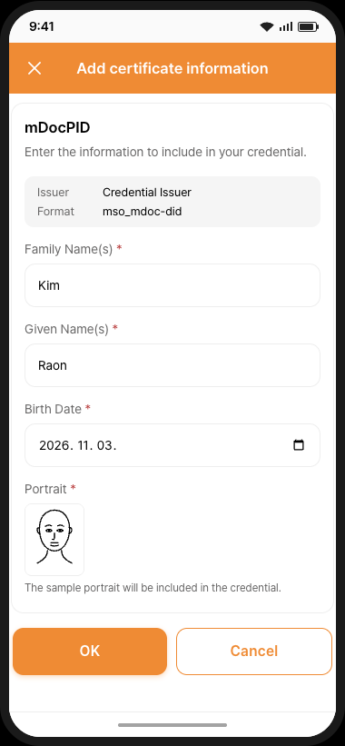

- `OID4VCI` certificates: the issuer and the format are shown, `Birth Date` uses a date picker, and `mDocPID` includes the sample portrait. `OK` continues and `Cancel` returns to the list.
- After `Save` or `OK`, enter the PIN to request issuance.
- (In the demo, `Save` and `OK` stay disabled until every required field is filled in.)
- (In the demo, issuing again follows these rules: an OpenDID VC (`Basic Person VC`, `Driver License VC`) replaces the one already held, whether it was issued from the list or by `Scan QR`; an mDoc or SD-JWT credential (`mDocPID`, `VerifiableIdSD`) is added as another card each time, and each card can be viewed, deleted and presented on its own.)

## issueProgress
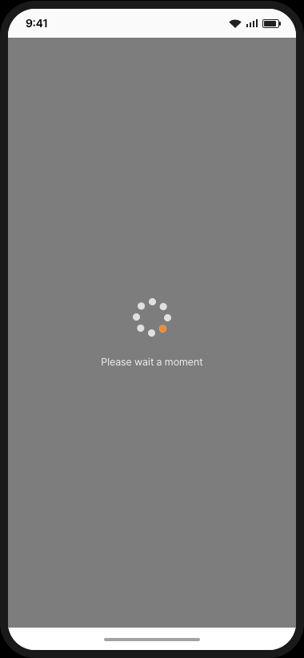

- The certificate is being issued. Wait until it finishes.

## issueSuccess
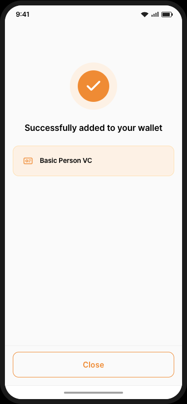

- The certificate has been added to the wallet.
- Press `Close` to return to the home screen.

## qrScanIssue
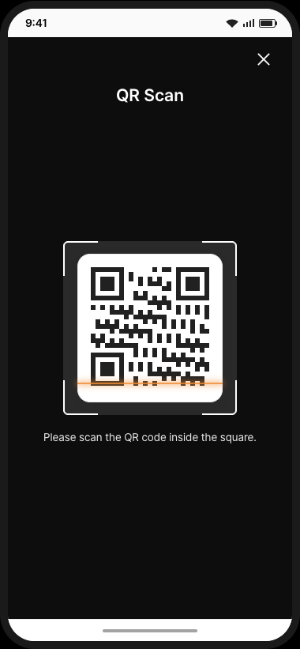

- Scan the issuance QR code shown by the issuer, inside the square.
- (In the demo, the scan completes automatically after about two seconds; after you enter the PIN, the credential chosen in the `Demo` popup is issued with the demo values, without the information form. `Basic Person VC` issued this way supports zero-knowledge proof (ZKP). The issuing-again rules are the same as for the list.)

## docs
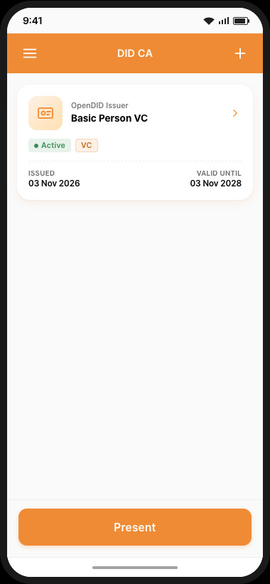

- The home screen with the list of issued certificates.
- Each card shows the issuer, the certificate name, its status and format, and the issue and expiry dates. (In the demo, when several cards of the same credential are held, the issue time is added after the issue date, matching the `(issued HH:MM:SS)` label in the presentation request.)
- Tap a card to see the certificate details.
- `Present` presents a certificate in person or by QR code.

## vcDetail
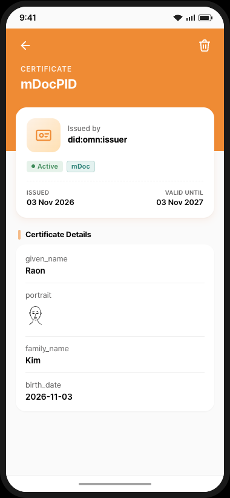

- The details of a certificate: issuer, status, format, issue and expiry dates, and the attributes it contains.
- The certificate can be deleted from this screen after PIN authentication.

## vcDetailZkp
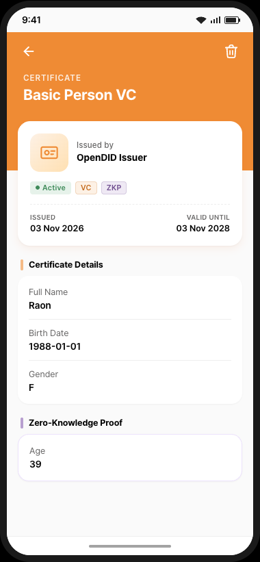

- The details of a certificate that supports zero-knowledge proof (ZKP). (In the demo, `Basic Person VC` issued by `Scan QR` supports ZKP; issued from the list, it does not.)
- The `Zero-Knowledge Proof` section shows the attributes that can be proven without revealing the value.

## homeAuth
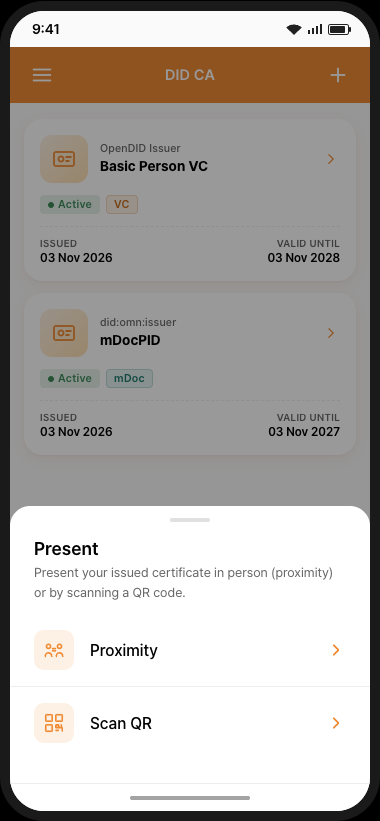

- The sheet for presenting a certificate.
- `Proximity` presents a certificate to a nearby verifier in person and opens the QR/NFC screen. (In the demo, it is available only when the wallet holds `mDocPID`; otherwise an `mDocPID required` popup is shown.)
- `Scan QR` scans the verifier's presentation request QR code and opens the request. (In the demo, a gray `Demo` popup first asks which held credential to present; `Cancel` stays on the home screen. If more than one credential of the chosen type is held, for example two `mDocPID` cards, the presentation request lets you choose one as `Option N of M`, labelled with its issue time.)

## proximity
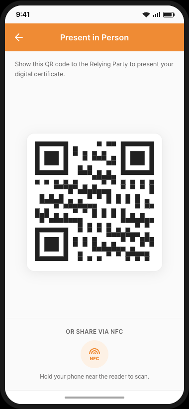

- Present a certificate in person.
- Show the QR code to the verifier, or hold the phone near the reader to share it over NFC. The wallet then shows the verifier's request, and after `Accept` and the PIN the certificate is sent.
- (In the demo, the verifier app appears next to the wallet. Choose the request on the verifier (`Full` or `Custom`), press `Start Verification`, then choose `Scan QR` (the scan completes automatically) or choose `Tap NFC` and press `Simulate NFC tap`. Keep the wallet on the proximity screen meanwhile. With `Full`, every attribute is `REQUIRED`. With `Custom`, the selected attributes are `REQUIRED` and the rest are `OPTIONAL`. If the wallet holds more than one `mDocPID`, choose one as `Option N of M`, labelled with its issue time. After `Accept` and the PIN, the verifier shows the received `mDocPID` attributes and the verification result. The verifier disappears when the wallet leaves the presentation flow, for example back to the home screen.)

## qrScan
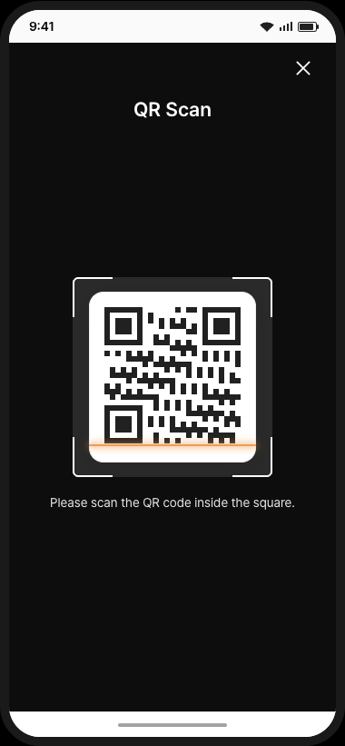

- Scan the verifier's presentation request QR code, inside the square. (In the demo, the scan completes automatically after about two seconds.)

## vpProgress

- The presentation request is being received. Wait until it finishes.

## vpRequest
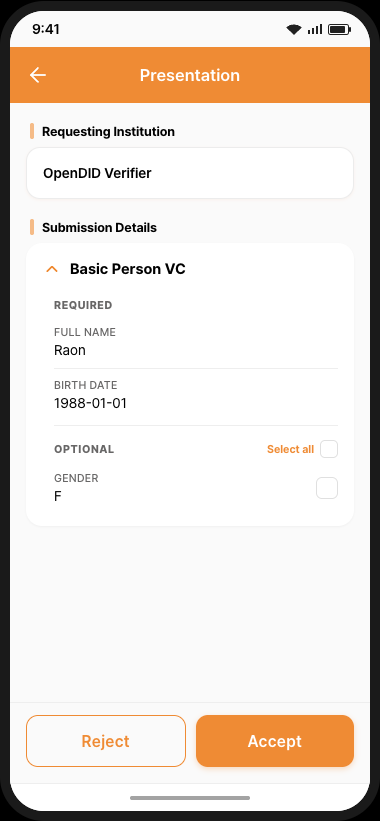

- The presentation request: the requesting institution and the certificate attributes it asks for. (In the demo, the requesting institution is `OpenDID Verifier` with `Scan QR` and `Proximity Verifier` with `Proximity`. With `Scan QR`, the attributes come from the credential chosen in the `Demo` popup; with `Proximity`, they are the `mDocPID` attributes the verifier requested.)
- `REQUIRED` attributes are always submitted. `OPTIONAL` attributes are submitted only if you select them.
- `Accept` submits after PIN authentication. `Reject` cancels the request.

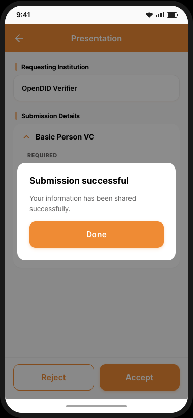

- When the submission succeeds, a popup is shown. Press `Done` to return to the home screen.

## vpRequestZkp
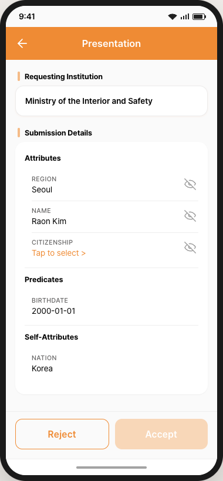

- A presentation request that uses zero-knowledge proof (ZKP).
- It shows the attributes, the predicates (conditions proven without revealing the value) and the self-attested attributes.
- (In the demo, the request uses selective disclosure, so this screen is shown for reference only.)

## menu
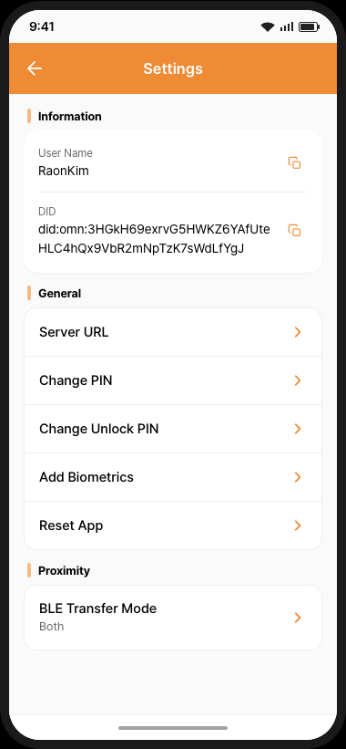

- Settings shows the user name and DID. (In the demo, the DID is a fixed sample value, and the user name is the `First Name` and `Last Name` entered at registration, joined without a space, for example `RaonKim`.)
- `Server URL`: shows and sets the server connection info. (In the demo, a popup says the feature is not available.)
- `Change PIN` · `Change Unlock PIN`: change the PINs. (In the demo, the Unlock PIN cannot be set, so `Change Unlock PIN` shows `Unlock PIN is not set`.)
- `Add Biometrics`: register biometric authentication. (In the demo, `Enable Biometrics` on that screen shows a popup saying the feature is not available.)
- `Reset App`: delete the wallet and start again from the splash screen.
- `BLE Transfer Mode`: choose the BLE role for in-person presentation.

## serverUrl
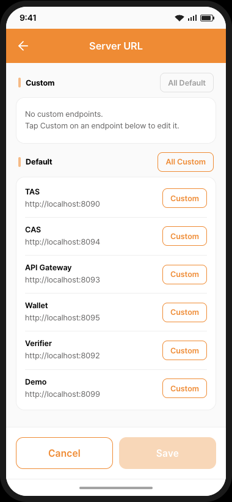

- Check or change the addresses of the servers the wallet connects to: TAS, CAS, API Gateway, Wallet, Verifier and Demo.
- `Default` lists the default addresses. Tap `Custom` on an endpoint to edit it.
- `Save` applies the changes. `Cancel` discards them.
- (In the demo, server settings are not available, so this screen is shown for reference only.)
