# Demo App 가이드 (V3.0.0.0)

## splash
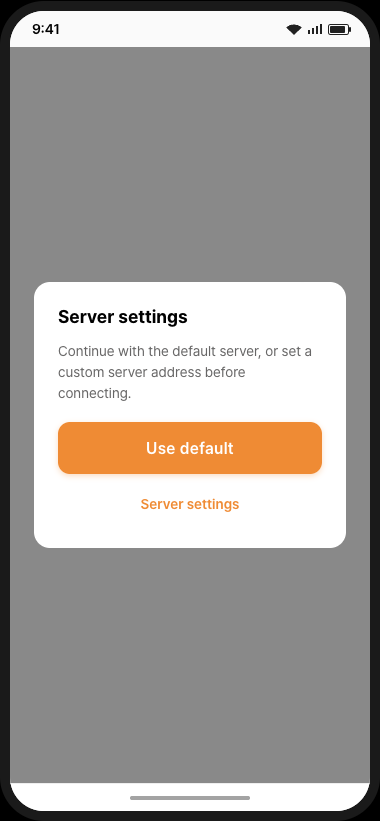

- 앱이 시작되면 스플래시 화면에서 접속할 서버를 묻습니다.
- `Use default` 를 누르면 기본 서버 주소로 접속하고 온보딩으로 넘어갑니다. (데모에서는 실제로 접속하지 않습니다)
- `Server settings` 를 누르면 서버 설정이 열려 서버 주소를 먼저 직접 설정할 수 있습니다. (데모에서는 제공하지 않으며, 제공하지 않는 기능이라는 팝업이 나타납니다)
- 월렛에 Unlock PIN 이 설정되어 있으면 Unlock PIN 입력 화면이 대신 열립니다. (데모에서는 Unlock PIN 을 설정할 수 없어 이 경우가 생기지 않습니다)

## onboarding
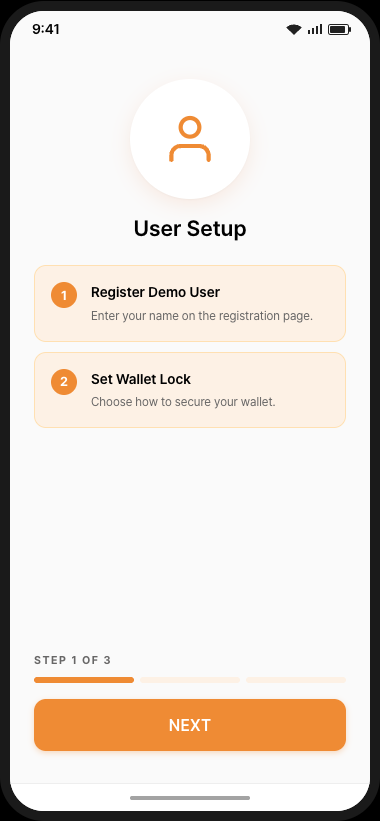

- 온보딩은 월렛 설정을 3단계로 안내합니다. `NEXT` 를 누르면 현재 단계를 진행합니다.
- **Step 1 – User Setup**: 사용자를 등록하고 월렛 잠금 설정 여부를 정합니다.

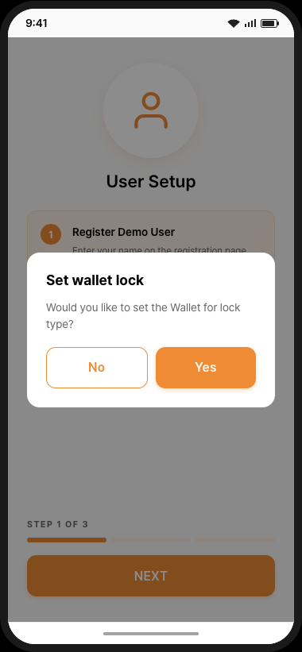

- 사용자 등록이 끝나면 월렛 잠금을 설정할지 묻는 팝업이 나타납니다.
  - `Yes` 를 누르면 월렛을 잠그는 Unlock PIN 을 등록합니다. (데모에서는 제공하지 않는 기능이라는 팝업이 나타나고, 잠금 팝업은 그대로 남습니다)
  - `No` 를 누르면 월렛 잠금을 설정하지 않습니다.

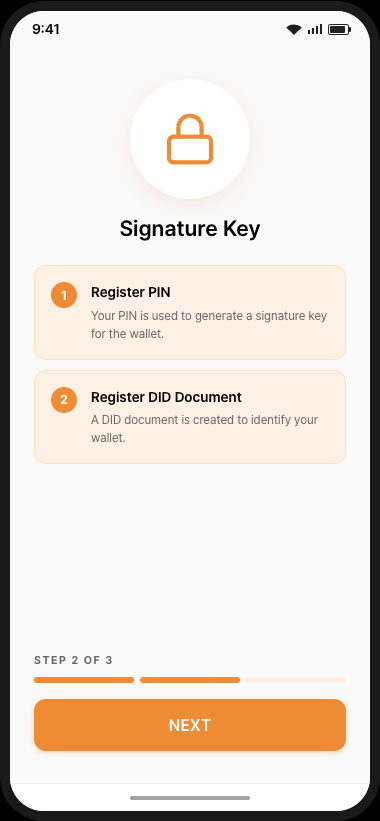

- **Step 2 – Signature Key**: 서명키 생성을 위한 PIN 을 등록하고 사용자 DID 문서를 생성합니다.

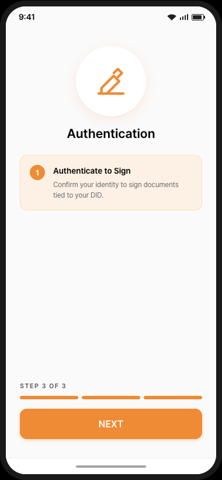

- **Step 3 – Authentication**: PIN 을 입력해 DID 문서에 서명하고 등록합니다. 완료되면 월렛이 열립니다.

## userInfoWebView
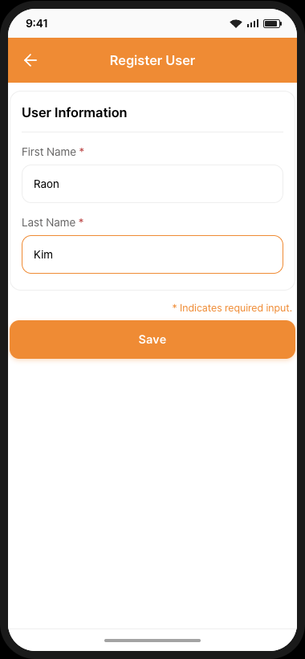

- Demo 서버가 제공하는 사용자 등록 페이지를 웹뷰로 보여 줍니다. (데모에서는 이 페이지를 흉내 낸 화면이며 아무것도 전송하지 않습니다)
- `First Name` 과 `Last Name` 을 입력하고 `Save` 를 누릅니다. (데모에서는 두 항목을 모두 입력해야 `Save` 가 활성화됩니다)

## pinRegister
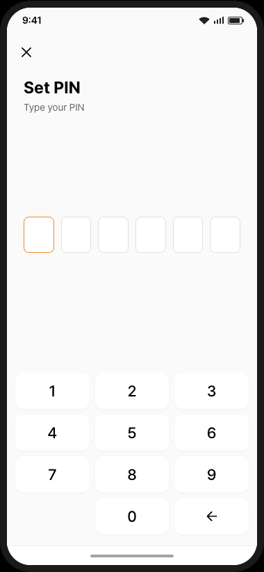

- 서명에 사용할 6자리 PIN 을 등록합니다.
- PIN 을 입력한 뒤 같은 PIN 을 한 번 더 입력해 확인합니다.
- 등록이 끝나면 생체인증 등록 화면으로 넘어갑니다.

## biometricRegister
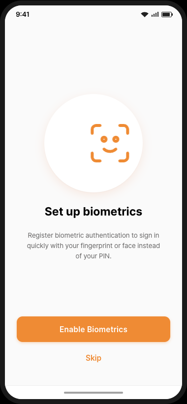

- PIN 입력 없이 서명할 수 있도록 생체인증(지문 또는 얼굴)을 등록합니다.
- `Enable Biometrics` 를 누르면 등록하고, `Skip` 을 누르면 PIN 만 사용합니다. (데모에서는 `Enable Biometrics` 를 누르면 제공하지 않는 기능이라는 팝업이 나타납니다)
- 설정 > `Add Biometrics` 에서도 이 화면을 열 수 있습니다.

## pinAuth
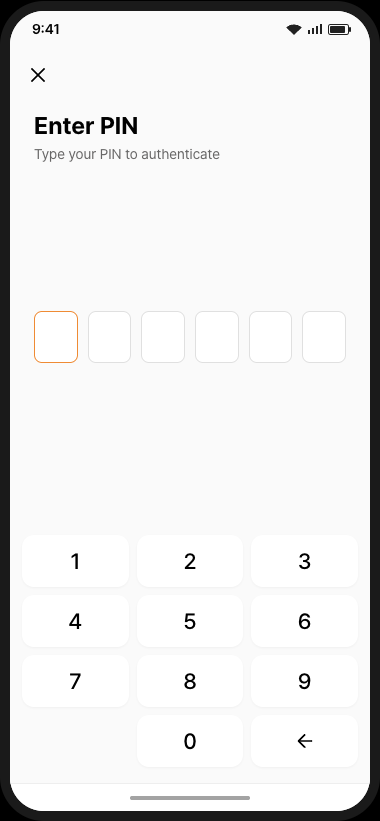

- 등록한 PIN 을 입력해 인증합니다. PIN 이 틀리면 오류 메시지가 표시되고 입력칸이 초기화되며, 메시지는 몇 초 뒤 사라집니다.
- DID 문서 등록, 증명서 발급, 증명서 제출처럼 서명이 필요할 때마다 이 화면이 나타납니다. 증명서를 삭제하기 전에도 사용자 인증을 받습니다.
- (데모에서는 온보딩에서 등록한 PIN, `Change PIN` 후에는 새 PIN 을 페이지 메모리에만 보관합니다. 페이지를 새로고침하거나 닫거나 `Reset App` 을 하면 지워지고 온보딩부터 다시 시작합니다)

## pinChange
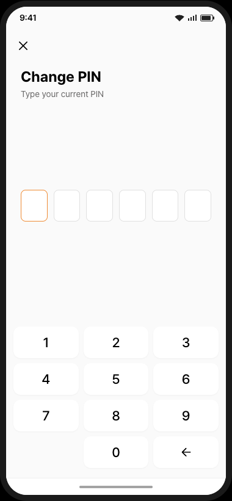

- 서명용 PIN 을 변경합니다. 설정 > `Change PIN` 에서 엽니다.
- 현재 PIN, 새 PIN, 새 PIN 확인 순서로 입력합니다. 현재 PIN 이 틀리면 오류 메시지가 표시되고 입력칸이 초기화됩니다.
- (데모에서는 현재 PIN 이 등록한 PIN 과 같아야 하고, 새 PIN 은 달라야 하며, 변경한 뒤에는 새 PIN 으로만 인증할 수 있습니다)

## unlockRegister
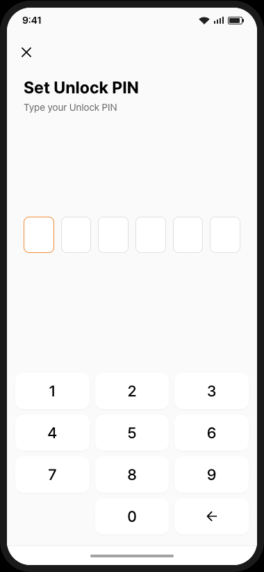

- 월렛을 잠그는 Unlock PIN 을 등록합니다.
- 온보딩 중 월렛 잠금 팝업에서 `Yes` 를 누르면 열립니다. (데모에서는 월렛 잠금을 제공하지 않아 이 화면에 도달하지 않으므로, 참고용으로만 보여 드립니다)
- Unlock PIN 을 입력한 뒤 한 번 더 입력해 확인합니다.

## unlockAuth
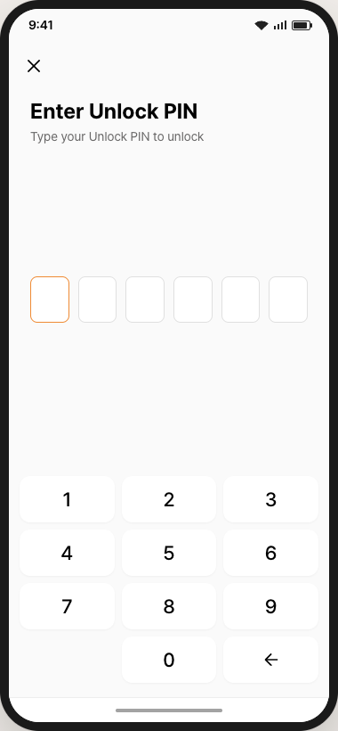

- 월렛에 Unlock PIN 이 설정되어 있으면 앱을 실행할 때 Unlock PIN 을 묻습니다.
- Unlock PIN 을 입력하면 월렛이 열립니다. 틀리면 오류 메시지가 표시되고 입력칸이 초기화되며, 메시지는 몇 초 뒤 사라집니다.
- (데모에서는 다시 실행하면 월렛이 초기화되므로, 이 화면은 참고용으로만 보여 드립니다)

## unlockChange
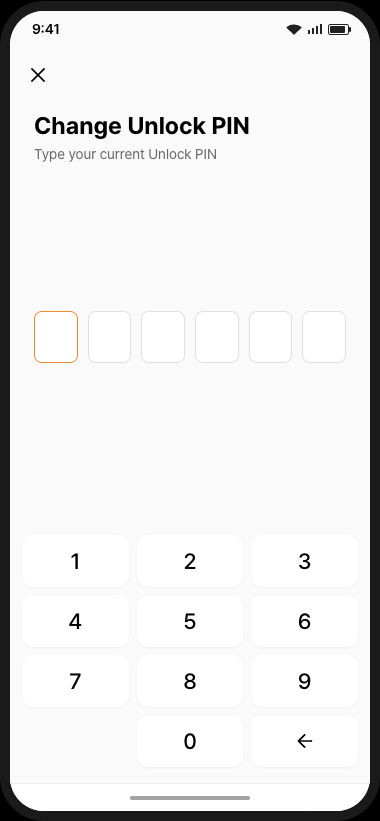

- Unlock PIN 을 변경합니다. 설정 > `Change Unlock PIN` 에서 엽니다.
- 현재 Unlock PIN, 새 Unlock PIN, 새 Unlock PIN 확인 순서로 입력합니다.
- (데모에서는 Unlock PIN 을 설정할 수 없어 대신 항상 `Unlock PIN is not set` 팝업이 나타납니다)

## authMethod
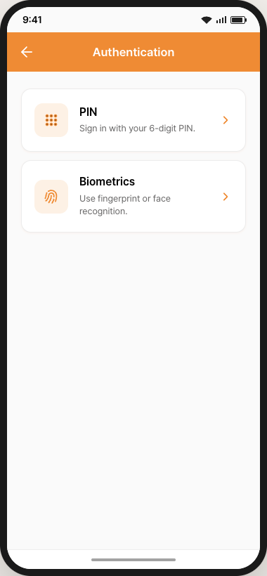

- 인증 방법으로 `PIN` 또는 `Biometrics` 를 선택합니다.
- 두 가지 인증 방법을 모두 등록한 월렛을 위한 화면입니다. (데모에서는 나타나지 않으며 참고용으로만 보여 드립니다)

## docsEmpty
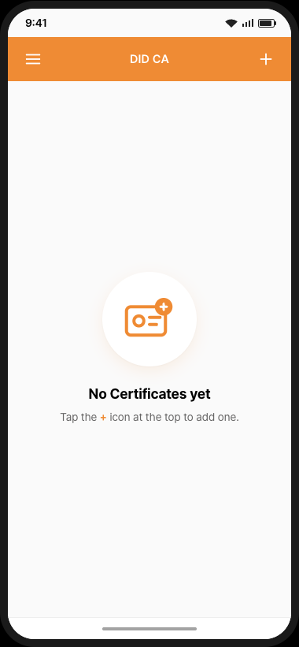

- 아직 발급받은 증명서가 없을 때의 홈 화면입니다.
- 상단의 `+` 아이콘이나 가운데의 카드 아이콘을 누르면 증명서를 추가할 수 있습니다.
- 왼쪽 위 메뉴 아이콘을 누르면 설정이 열립니다.

## docsAdd
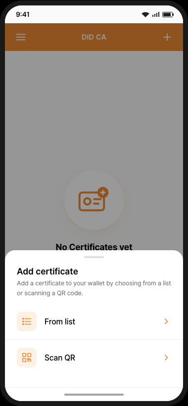

- 증명서를 추가하는 시트입니다.
- `From list`: 발급기관 목록에서 증명서를 선택합니다 (사용자 주도 발급).
- `Scan QR`: 발급 QR 코드를 스캔합니다 (발급기관 주도 발급). (데모에서는 실제 발급 QR 코드가 없으므로 먼저 회색 `Demo` 팝업에서 발급할 증명서를 고릅니다. `Cancel` 을 누르면 홈 화면에 머뭅니다)

## protocolSelect
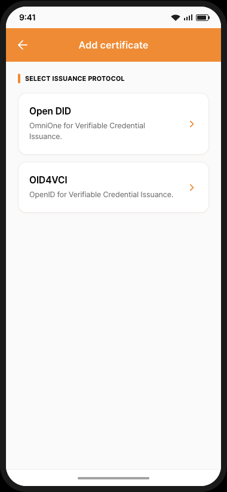

- 발급 프로토콜을 선택합니다.
- `Open DID`: OmniOne for Verifiable Credential Issuance. OpenDID VC 증명서 목록이 나옵니다.
- `OID4VCI`: OpenID for Verifiable Credential Issuance. mDoc · SD-JWT 증명서 목록이 나옵니다.

## docsAddList
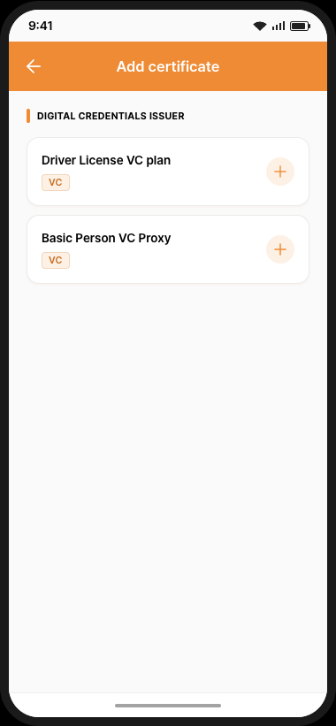

- 선택한 발급 프로토콜로 발급받을 수 있는 증명서 목록입니다. (데모에서는 프로토콜별 2종으로 고정되어 있습니다)
- `Open DID` 를 선택하면 OpenDID VC 증명서(`VC` 뱃지)가 나옵니다.

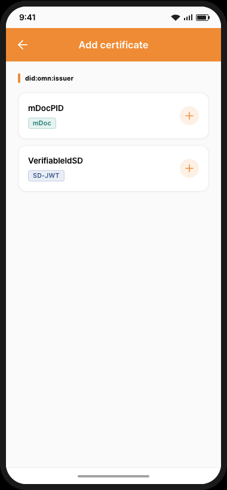

- `OID4VCI` 를 선택하면 mDoc · SD-JWT 증명서(`mDoc` · `SD-JWT` 뱃지)가 나옵니다.
- 증명서를 선택하면 정보 입력 화면이 열리고, 그 뒤 PIN 을 입력하면 발급을 요청합니다.

## issueForm
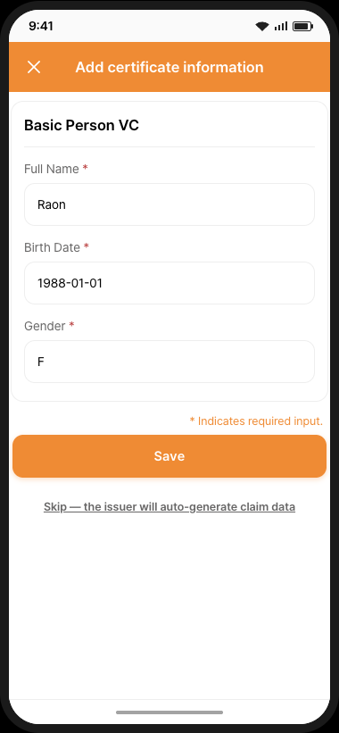

- 증명서에 담을 정보를 입력합니다. 발급된 증명서에는 저장한 값이 담깁니다. (데모에서는 입력란이 데모 값으로 미리 채워져 있고 바꿀 수 있습니다)
- `Open DID` 증명서: `*` 표시 항목은 필수입니다. `Save` 를 누르면 진행하고, `Skip` 은 발급기관이 클레임 데이터를 생성한다는 문구의 링크입니다. `X` 를 누르면 확인 없이 목록으로 돌아갑니다. (데모에서는 `Skip` 을 누르면 데모 값을 사용합니다)

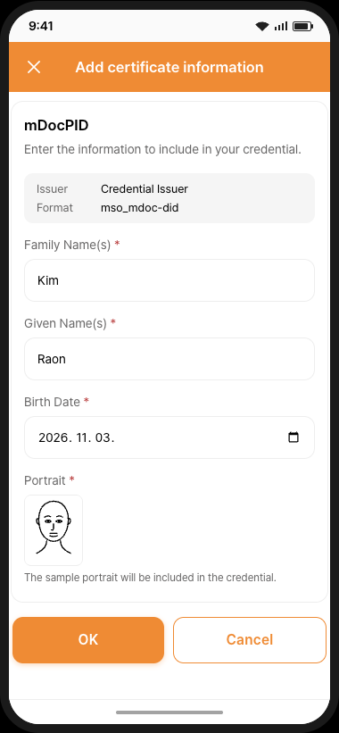

- `OID4VCI` 증명서: 발급기관과 형식이 표시되고, `Birth Date` 는 날짜 선택기로 입력하며, `mDocPID` 에는 샘플 얼굴 사진이 포함됩니다. `OK` 를 누르면 진행하고 `Cancel` 을 누르면 목록으로 돌아갑니다.
- `Save` 나 `OK` 를 누른 뒤 PIN 을 입력하면 발급을 요청합니다.
- (데모에서는 필수 항목을 모두 채워야 `Save` · `OK` 가 활성화됩니다)
- (데모에서는 다시 발급할 때 다음 규칙을 따릅니다: OpenDID VC(`Basic Person VC`, `Driver License VC`)는 목록·`Scan QR` 어느 경로든 보유한 것을 교체하고, mDoc · SD-JWT 증명서(`mDocPID`, `VerifiableIdSD`)는 발급할 때마다 카드가 하나씩 추가되며 카드마다 따로 보고 삭제하고 제출할 수 있습니다)

## issueProgress

- 증명서를 발급하는 중입니다. 완료될 때까지 기다립니다.

## issueSuccess
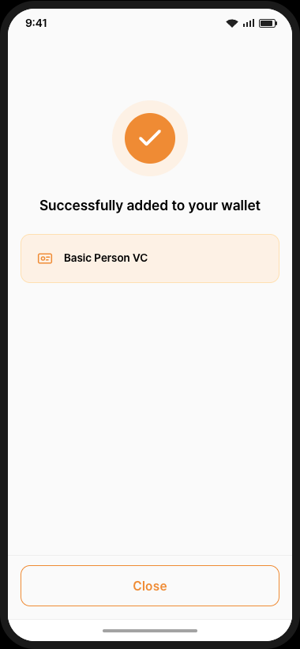

- 증명서가 월렛에 추가되었습니다.
- `Close` 를 누르면 홈 화면으로 돌아갑니다.

## qrScanIssue
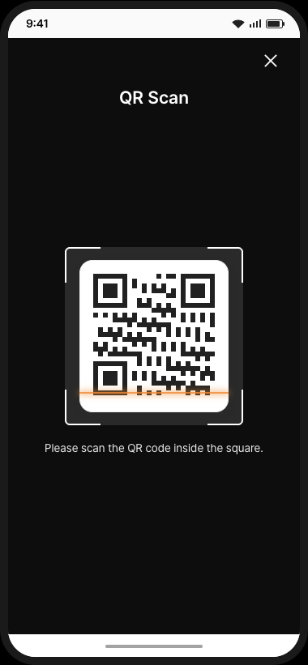

- 발급기관이 보여 주는 발급 QR 코드를 사각형 안에 맞춰 스캔합니다.
- (데모에서는 약 2초 뒤 스캔이 자동으로 완료되고, PIN 을 입력하면 `Demo` 팝업에서 고른 증명서가 정보 입력 화면 없이 데모 값으로 발급됩니다. 이 경로로 발급한 `Basic Person VC` 는 영지식 증명(ZKP)을 지원합니다. 다시 발급할 때의 규칙은 목록과 같습니다)

## docs
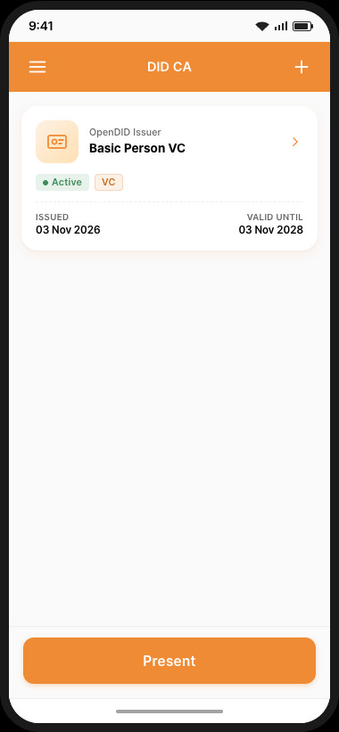

- 발급받은 증명서 목록이 있는 홈 화면입니다.
- 각 카드에는 발급기관, 증명서 이름, 상태와 형식, 발급일과 만료일이 표시됩니다. (데모에서는 같은 증명서 카드를 여러 장 보유하면 발급일 뒤에 발급 시각이 붙으며, 제출 요청의 `(issued HH:MM:SS)` 표시와 같습니다)
- 카드를 누르면 증명서 상세 화면이 열립니다.
- `Present` 를 누르면 대면 또는 QR 코드로 증명서를 제출합니다.

## vcDetail
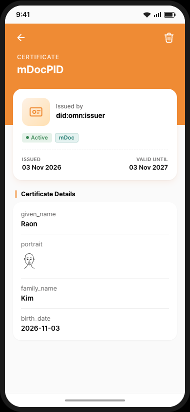

- 증명서의 상세 정보입니다: 발급기관, 상태, 형식, 발급일과 만료일, 증명서에 담긴 속성.
- 이 화면에서 증명서를 삭제할 수 있으며, 삭제하기 전에 PIN 인증을 받습니다.

## vcDetailZkp
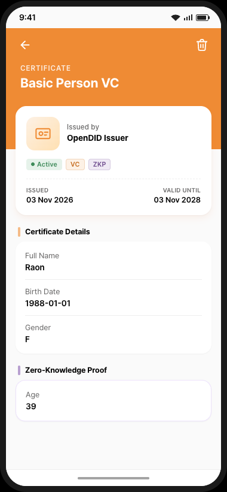

- 영지식 증명(ZKP)을 지원하는 증명서의 상세 정보입니다. (데모에서는 `Scan QR` 로 발급한 `Basic Person VC` 가 ZKP 를 지원하며, 목록에서 발급하면 지원하지 않습니다)
- `Zero-Knowledge Proof` 영역에는 값을 드러내지 않고 증명할 수 있는 속성이 표시됩니다.

## homeAuth
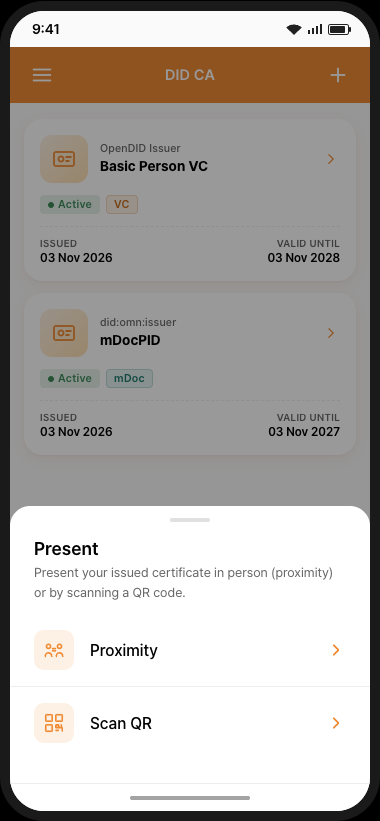

- 증명서를 제출하는 시트입니다.
- `Proximity`: 가까이 있는 검증자에게 대면으로 증명서를 제출하며, QR/NFC 화면으로 넘어갑니다. (데모에서는 월렛에 `mDocPID` 가 있을 때만 사용할 수 있으며, 없으면 `mDocPID required` 팝업이 나타납니다)
- `Scan QR`: 검증자의 제출 요청 QR 코드를 스캔하고 제출 요청 화면을 엽니다. (데모에서는 먼저 회색 `Demo` 팝업에서 제출할 보유 증명서를 고르며, `Cancel` 을 누르면 홈 화면에 머뭅니다. 고른 종류를 여러 장 보유하면(예: `mDocPID` 2장) 제출 요청 화면에서 발급 시각이 표시된 `Option N of M` 으로 하나를 고릅니다)

## proximity
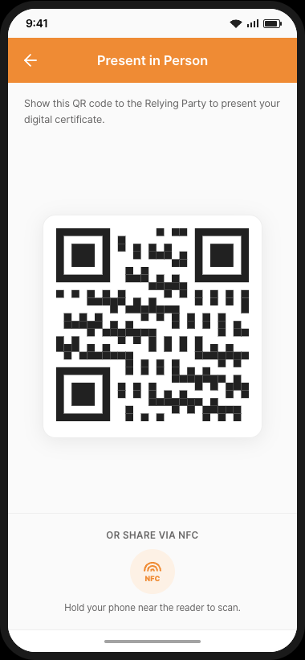

- 대면으로 증명서를 제출합니다.
- 검증자에게 QR 코드를 보여 주거나, 휴대폰을 리더기에 가까이 대어 NFC 로 공유합니다. 그러면 월렛에 검증자의 요청이 표시되고, `Accept` 와 PIN 인증 후 증명서가 전송됩니다.
- (데모에서는 월렛 옆에 검증자 앱이 나타납니다. 검증자에서 요청(`Full` 또는 `Custom`)을 고르고 `Start Verification` 을 누른 뒤, `Scan QR` 을 고르거나(스캔은 자동으로 완료됩니다) `Tap NFC` 를 골라 `Simulate NFC tap` 을 누릅니다. 그동안 월렛은 근접 제출 화면에 둡니다. `Full` 이면 모든 속성이 `REQUIRED` 이고, `Custom` 이면 선택한 속성은 `REQUIRED`, 나머지는 `OPTIONAL` 입니다. `mDocPID` 를 여러 장 보유하면 발급 시각이 표시된 `Option N of M` 으로 하나를 고릅니다. `Accept` 와 PIN 인증 후 검증자에 수신한 `mDocPID` 속성과 검증 결과가 표시됩니다. 월렛이 제출 흐름을 벗어나면(예: 홈 화면으로 돌아가면) 검증자는 사라집니다)

## qrScan
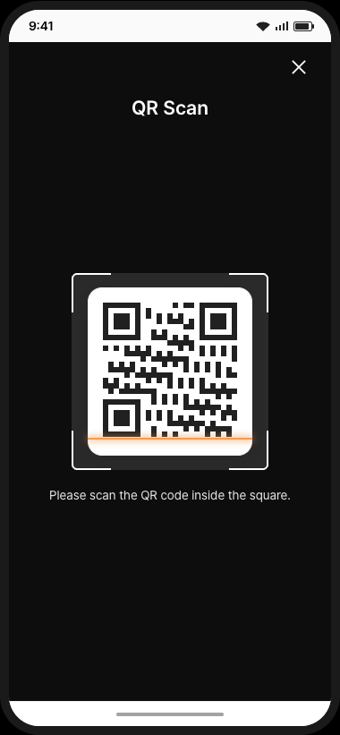

- 검증자의 제출 요청 QR 코드를 사각형 안에 맞춰 스캔합니다. (데모에서는 약 2초 뒤 스캔이 자동으로 완료됩니다)

## vpProgress
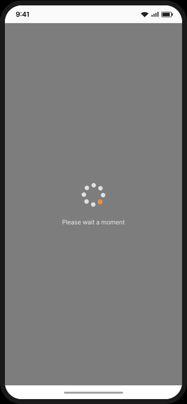

- 제출 요청을 받는 중입니다. 완료될 때까지 기다립니다.

## vpRequest
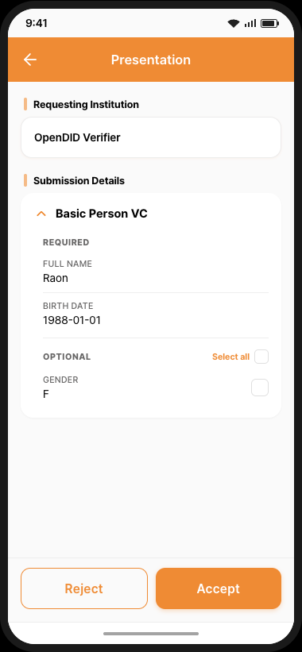

- 제출 요청 화면입니다: 요청 기관과 요청한 증명서 속성이 표시됩니다. (데모에서는 요청 기관이 `Scan QR` 에서는 `OpenDID Verifier`, `Proximity` 에서는 `Proximity Verifier` 입니다. `Scan QR` 에서는 `Demo` 팝업에서 고른 증명서의 속성을, `Proximity` 에서는 검증자가 요청한 `mDocPID` 속성을 보여 줍니다)
- `REQUIRED` 속성은 항상 제출되고, `OPTIONAL` 속성은 선택한 것만 제출됩니다.
- `Accept` 를 누르면 PIN 인증 후 제출하고, `Reject` 를 누르면 요청을 거절합니다.

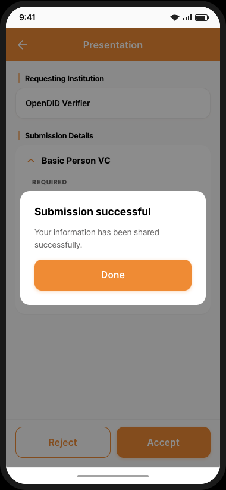

- 제출에 성공하면 팝업이 나타납니다. `Done` 을 누르면 홈 화면으로 돌아갑니다.

## vpRequestZkp
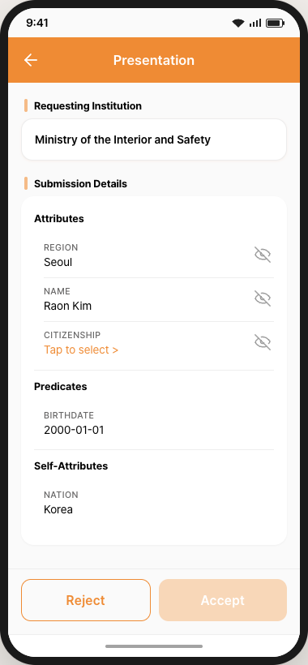

- 영지식 증명(ZKP)을 사용하는 제출 요청 화면입니다.
- 속성, 술어(값을 드러내지 않고 증명하는 조건), 자기 증명 속성을 보여 줍니다.
- (데모에서는 제출 요청이 선택적 공개 방식이므로, 이 화면은 참고용으로만 보여 드립니다)

## menu
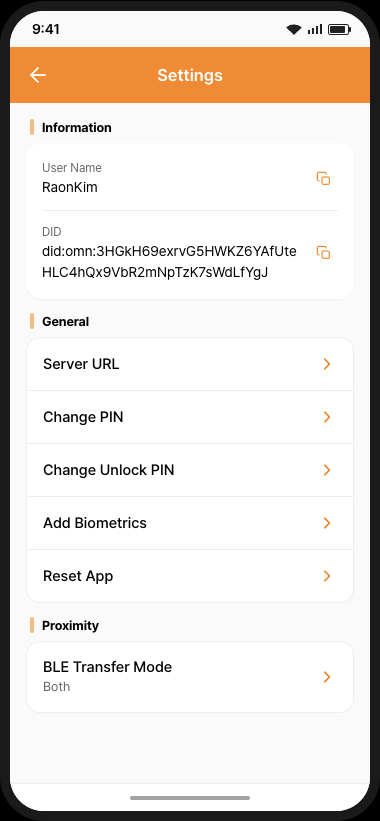

- 설정 화면에는 사용자 이름과 DID 가 표시됩니다. (데모에서는 DID 가 고정 샘플 값이고, 사용자 이름은 등록할 때 입력한 `First Name` 과 `Last Name` 을 띄어쓰기 없이 이어 붙인 값입니다. 예: `RaonKim`)
- `Server URL`: 접속 서버 정보를 표시 및 설정할 수 있는 화면입니다. (데모에서는 제공하지 않으며, 제공하지 않는 기능이라는 팝업이 나타납니다)
- `Change PIN` · `Change Unlock PIN`: PIN 을 변경합니다. (데모에서는 Unlock PIN 을 설정할 수 없어 `Change Unlock PIN` 을 누르면 `Unlock PIN is not set` 이 나타납니다)
- `Add Biometrics`: 생체인증을 등록합니다. (데모에서는 그 화면의 `Enable Biometrics` 를 누르면 제공하지 않는 기능이라는 팝업이 나타납니다)
- `Reset App`: 월렛을 삭제하고 스플래시 화면부터 다시 시작합니다.
- `BLE Transfer Mode`: 대면 제출 시 사용할 BLE 역할을 선택합니다.

## serverUrl
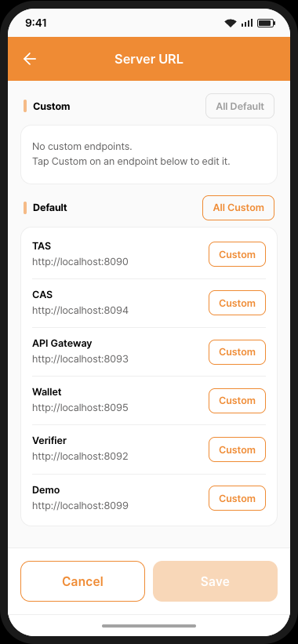

- 월렛이 접속하는 서버 주소를 확인하거나 변경합니다: TAS, CAS, API Gateway, Wallet, Verifier, Demo.
- `Default` 영역에 기본 주소가 표시되며, 항목의 `Custom` 을 누르면 편집할 수 있습니다.
- `Save` 를 누르면 변경 내용을 적용하고, `Cancel` 을 누르면 취소합니다.
- (데모에서는 서버 설정을 제공하지 않아 이 화면은 참고용으로만 보여 드립니다)
