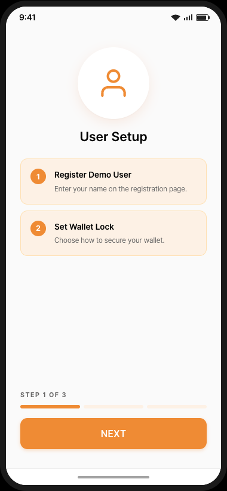
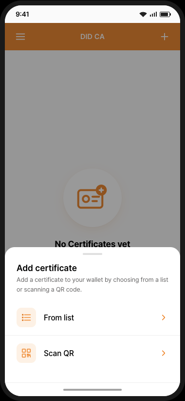
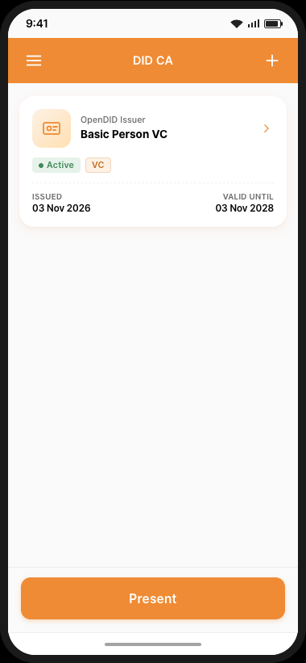
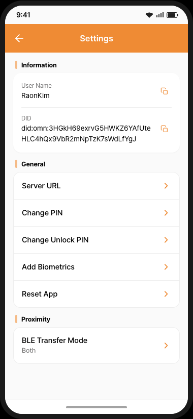

# Demo App Guide (V3.0.0.0)

This version shows the screen flow of the **did-ca 3.0** wallet app.  
The screens are an interactive prototype: no server is called, and every result is simulated.  
The demo proceeds in the following order: **Onboarding → VC Issuance → VP Submission**.  
On each screen, press the `?` button at the bottom to see the guide for that screen.

---

## Onboarding

1. On the splash screen, press `Use default` to connect with the default servers. (In the demo, no connection is made.)
2. **Step 1 – User Setup**: register a user (`First Name`, `Last Name`), then choose whether to set a wallet lock (`Yes` registers an Unlock PIN). (In the demo, the wallet lock is not available, so choose `No`.)
3. **Step 2 – Signature Key**: register a 6-digit PIN for signing, and register biometrics or press `Skip`. (In the demo, biometrics are not available, so press `Skip`.)
4. **Step 3 – Authentication**: enter the PIN to sign and register the DID document.

When onboarding is done, the home screen opens with no certificates.

---

## VC Issuance

Tap `+` on the home screen and choose how to add a certificate.

### From list (User-Initiated)
1. Select `From list`, then select the issuance protocol.
   - `Open DID`: OpenDID VC certificates, for example `Basic Person VC Proxy`.
   - `OID4VCI`: mDoc and SD-JWT certificates, for example `mDocPID`.
2. Select a certificate from the list.
3. Enter the information on the `Add certificate information` screen, then press `Save` (Open DID) or `OK` (OID4VCI). (In the demo, the fields are filled in with demo values that you can change.)
4. Enter the PIN. The certificate is issued and added to the wallet.

### Scan QR (Issuer-Initiated)
1. Select `Scan QR` and scan the issuer's QR code to receive the certificate. (In the demo, a `Demo` popup first asks which credential to issue; after the scan, enter the PIN and the credential is added to the wallet. `Basic Person VC` issued this way supports zero-knowledge proof (ZKP).)

---

## VP Submission

Press `Present` on the home screen and choose how to submit.

### Scan QR
1. Select `Scan QR` and scan the verifier's request QR code. (In the demo, a `Demo` popup first asks which held credential to present.)
2. Check the requesting institution and the requested attributes. Select the optional attributes to submit.
3. Press `Accept` and enter the PIN to submit.

### Proximity
1. Select `Proximity` to open the QR/NFC screen. (In the demo, the wallet must hold `mDocPID`, issued from `+` > `From list` > `OID4VCI`; otherwise an `mDocPID required` popup is shown.)
2. Show the QR code to the verifier, or hold the phone near the reader (NFC).
3. Accept the verifier's request on the wallet and enter the PIN. (In the demo, the verifier app appears next to the wallet; start the verification on the verifier first, and it shows the received credential.)

---

## Settings

Open Settings from the menu icon on the home screen. You can check the user name and DID, change the server addresses and the PINs, add biometrics and reset the app. (In the demo, server settings and biometrics are not available.)
