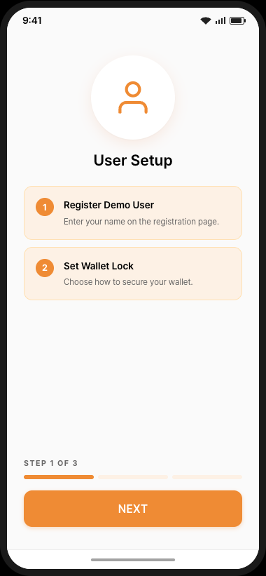
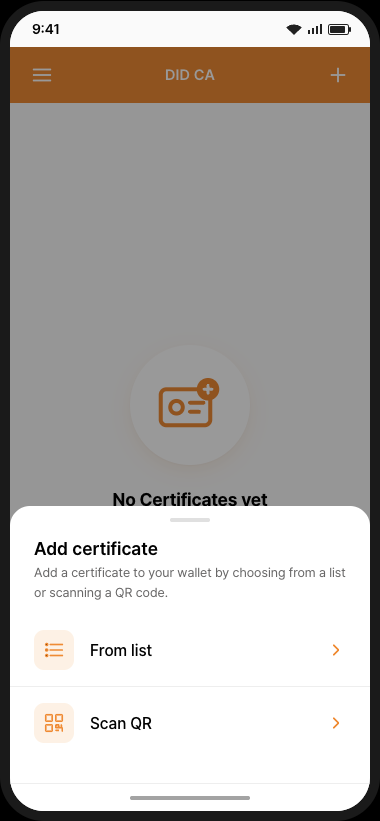
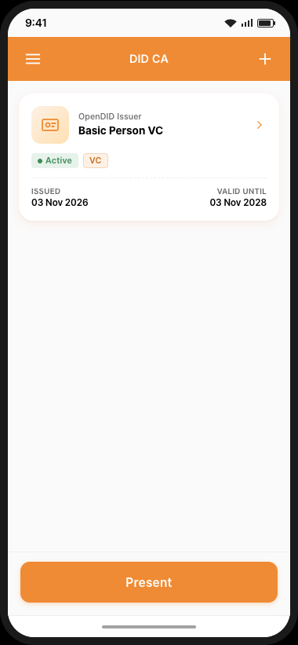
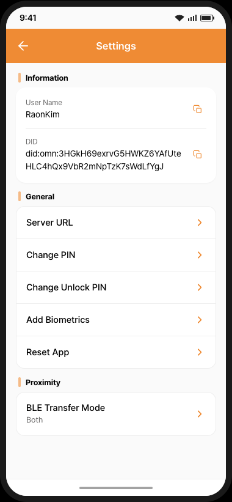

# Demo App 가이드 (V3.0.0.0)

이 버전은 **did-ca 3.0** 월렛 앱의 화면 흐름을 보여 줍니다.  
화면은 클릭으로 진행하는 프로토타입이며, 서버를 호출하지 않고 모든 결과를 모의로 보여 줍니다.  
데모는 **온보딩 → VC 발급 → VP 제출** 순서로 진행됩니다.  
각 화면에서 하단의 `?` 버튼을 누르면 그 화면의 가이드를 볼 수 있습니다.

---

## 온보딩

1. 스플래시 화면에서 `Use default` 를 눌러 기본 서버로 접속합니다. (데모에서는 실제로 접속하지 않습니다)
2. **Step 1 – User Setup**: 사용자(`First Name`, `Last Name`)를 등록하고, 월렛 잠금 설정 여부를 선택합니다(`Yes` 를 누르면 Unlock PIN 을 등록). (데모에서는 월렛 잠금을 제공하지 않으므로 `No` 를 선택합니다)
3. **Step 2 – Signature Key**: 서명용 6자리 PIN 을 등록하고, 생체인증을 등록하거나 `Skip` 을 누릅니다. (데모에서는 생체인증을 제공하지 않으므로 `Skip` 을 누릅니다)
4. **Step 3 – Authentication**: PIN 을 입력해 DID 문서에 서명하고 등록합니다.

온보딩이 끝나면 증명서가 없는 홈 화면이 열립니다.

---

## VC 발급

홈 화면에서 `+` 를 누르고 증명서 추가 방법을 선택합니다.

### From list (사용자 주도)
1. `From list` 를 선택한 뒤 발급 프로토콜을 선택합니다.
   - `Open DID`: OpenDID VC 증명서. 예: `Basic Person VC Proxy`.
   - `OID4VCI`: mDoc · SD-JWT 증명서. 예: `mDocPID`.
2. 목록에서 증명서를 선택합니다.
3. `Add certificate information` 화면에서 정보를 입력한 뒤 `Save`(Open DID) 또는 `OK`(OID4VCI)를 누릅니다. (데모에서는 데모 값이 미리 채워져 있고 바꿀 수 있습니다)
4. PIN 을 입력하면 증명서가 발급되어 월렛에 추가됩니다.

### Scan QR (발급기관 주도)
1. `Scan QR` 을 선택하고 발급기관의 QR 코드를 스캔해 증명서를 받습니다. (데모에서는 먼저 `Demo` 팝업에서 발급할 증명서를 고르고, 스캔 뒤 PIN 을 입력하면 월렛에 추가됩니다. 이 경로로 발급한 `Basic Person VC` 는 영지식 증명(ZKP)을 지원합니다)

---

## VP 제출

홈 화면에서 `Present` 를 누르고 제출 방법을 선택합니다.

### Scan QR
1. `Scan QR` 을 선택하고 검증자의 요청 QR 코드를 스캔합니다. (데모에서는 먼저 `Demo` 팝업에서 제출할 보유 증명서를 고릅니다)
2. 요청 기관과 요청 속성을 확인하고, 제출할 선택 속성을 고릅니다.
3. `Accept` 를 누르고 PIN 을 입력하면 제출됩니다.

### Proximity
1. `Proximity` 를 선택하면 QR/NFC 화면이 열립니다. (데모에서는 월렛에 `+` > `From list` > `OID4VCI` 에서 발급한 `mDocPID` 가 있어야 하며, 없으면 `mDocPID required` 팝업이 나타납니다)
2. 검증자에게 QR 코드를 보여 주거나, 휴대폰을 리더기에 가까이 댑니다 (NFC).
3. 월렛에서 검증자의 요청을 수락하고 PIN 을 입력합니다. (데모에서는 월렛 옆에 검증자 앱이 나타납니다. 먼저 검증자에서 검증을 시작하며, 검증자에 수신한 증명서가 표시됩니다)

---

## 설정

홈 화면의 메뉴 아이콘으로 설정을 엽니다. 사용자 이름과 DID 를 확인하고, 서버 주소와 PIN 변경, 생체인증 추가, 앱 초기화를 할 수 있습니다. (데모에서는 서버 설정과 생체인증을 제공하지 않습니다)
